<p align="center">
  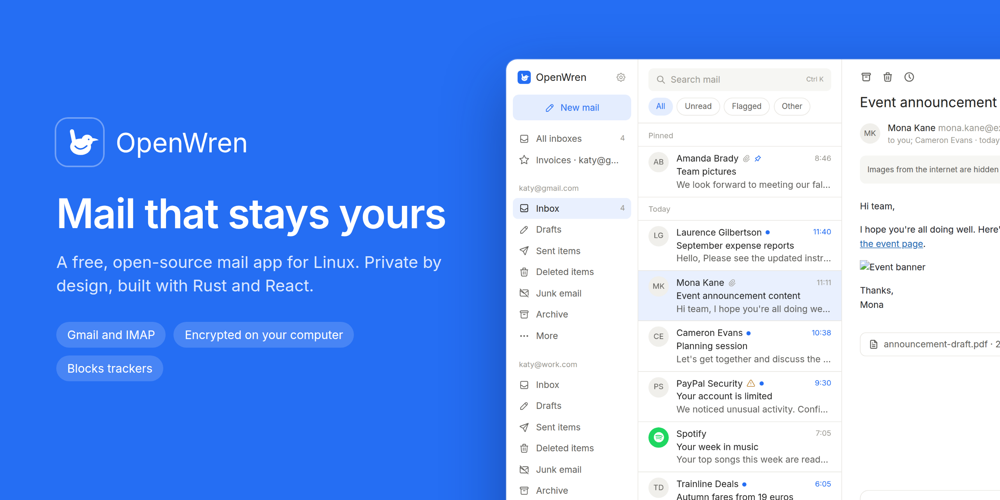
</p>

# OpenWren

A modern, privacy-first mail app that keeps your mail on your computer. Free
and open source, for Linux, with [macOS and Windows previews](https://openwren.app/download/).
It is built with **Rust** (the engine: sync, search, encryption) and **React**
(the interface), which makes it small and fast: a 14 MB download that starts in
about half a second.

Gmail and any IMAP account, one inbox for all of them, search that reaches back
years, and protection against trackers and phishing built in.

**If you like it, please star it.** It is the simplest way to help the project
get found.

<a href="https://www.star-history.com/?repos=vincegher%2Fopenwren&type=date&legend=top-left">
 <picture>
   <source media="(prefers-color-scheme: dark)" srcset="https://api.star-history.com/chart?repos=vincegher/openwren&type=date&theme=dark&legend=top-left" />
   <source media="(prefers-color-scheme: light)" srcset="https://api.star-history.com/chart?repos=vincegher/openwren&type=date&legend=top-left" />
   
 </picture>
</a>

| Light | Dark |
| --- | --- |
| 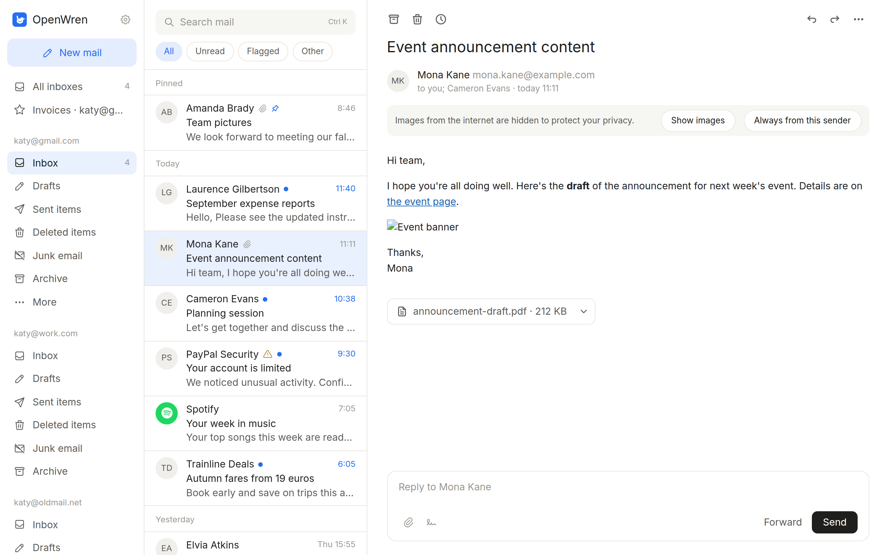 | 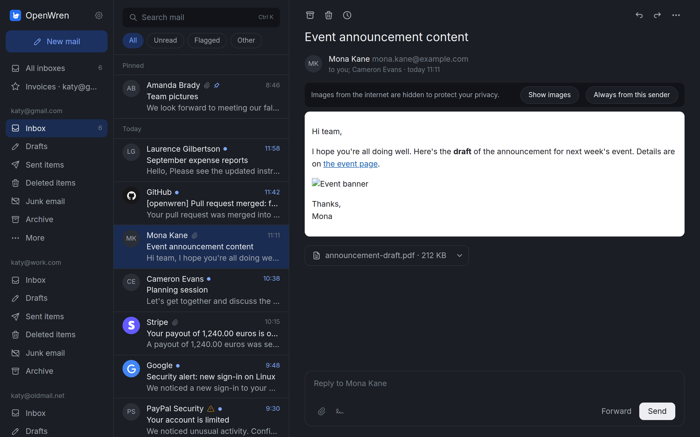 |

## Why OpenWren

- **Free.** No price, no account with us, no ads, no upsell.
- **Open source.** Apache-2.0. Every line is public: read it, build it, fork it.
- **Built because I could not find a mail app for Linux that I liked.** I wanted
  something modern, fast and private, so I wrote it.
- **Private.** Mail is stored encrypted on your computer. Trackers are removed
  and suspicious mail is flagged before you click.

## Fast

Measured on this project's own benchmarks, on an encrypted mailbox of 200,000
messages (Intel Core Ultra 7 155H laptop, Ubuntu 26.04):

| | |
| --- | --- |
| Start the app until the inbox is on screen | **0.6 s** |
| Open a folder | **0.1 ms** |
| Open a message | **0.05 ms** |
| Search for a word found in a few hundred messages | **30 ms** |
| Search for a word found in most of the mailbox | 185 ms |
| Sync from a local server | 2,750 headers and 540 message texts per second |
| Processor use while idle in the tray | 0.2% of one core |
| Memory with the inbox open | 288 MB, mostly the system web view |
| Download | 14 MB |

Folder and message times are the database work in the Rust engine; drawing
them on screen comes on top. Start-up, memory and idle use were measured on a
50,000-message mailbox.

Method, all numbers and how to rerun them: [docs/benchmarks.md](docs/benchmarks.md).

## Install

Packages are not published yet. Until the first release, build from source
(below). After it, these will work:

**Debian, Ubuntu and derivatives**

```bash
curl -fsSL https://packages.openwren.app/key.gpg | sudo tee /usr/share/keyrings/openwren.gpg > /dev/null
```

```bash
echo "deb [arch=amd64 signed-by=/usr/share/keyrings/openwren.gpg] https://packages.openwren.app/apt stable main" | sudo tee /etc/apt/sources.list.d/openwren.list
```

```bash
sudo apt update && sudo apt install openwren
```

**Fedora and other dnf systems**

```bash
sudo curl -fsSL -o /etc/yum.repos.d/openwren.repo https://packages.openwren.app/rpm/openwren.repo
```

```bash
sudo dnf install openwren
```

**AppImage:** download it from the [latest release](https://github.com/VinceGHER/openwren/releases/latest), make it executable and run it.

### Build from source

You need Node.js 22 or later with pnpm, Rust 1.77 or later, and Tauri's Linux libraries:

```bash
sudo apt install -y rustc cargo libwebkit2gtk-4.1-dev libgtk-3-dev libayatana-appindicator3-dev librsvg2-dev libssl-dev libxdo-dev pkg-config
```

```bash
pnpm install
```

```bash
pnpm tauri build --bundles deb
```

The package lands in `src-tauri/target/release/bundle/deb/`. To add the app to
your menu without installing the package, run `sh scripts/install-launcher.sh`.

## Uninstall

Removing the package takes away the program, its menu entry and its icons:

```bash
sudo apt remove openwren
```

```bash
sudo dnf remove openwren
```

Like other Linux apps, this leaves your own data in place, so that a reinstall
finds your accounts and mail again. To remove everything, quit OpenWren first
(tray icon → Quit), then delete these three things.

| What | Where | Remove it with |
| --- | --- | --- |
| Downloaded mail, search index, drafts and settings (the encrypted database) | `~/.local/share/org.openwren.app/` | `rm -rf ~/.local/share/org.openwren.app` |
| The start-at-login entry | `~/.config/autostart/openwren.desktop` | `rm -f ~/.config/autostart/openwren.desktop` |
| Account passwords and the database key | The system keyring, under the name "OpenWren" | `secret-tool clear service OpenWren` |

`secret-tool` is in the package `libsecret-tools` (Debian, Ubuntu) or
`libsecret` (Fedora). Without it, open "Passwords and Keys", search for
"OpenWren" and delete the entries.

This deletes only the copy on this computer: your mail stays on your mail
servers. The database cannot be read without the key from the keyring, so once
the keyring entries are gone a leftover database file is unreadable anyway.

If you ran `scripts/install-launcher.sh` from a source checkout, undo it with
`sh scripts/install-launcher.sh remove`.

## Adding your mail

- **Gmail:** choose Google, then follow the three steps to create an app
  password in your Google account (it needs 2-step verification). Advanced:
  sign in with Google using your own OAuth client ID.
- **Any other account:** enter your address and password; the server names are
  guessed from the address and can be corrected.

Passwords are stored in the system keyring, never in OpenWren's files.

## Features

<table>
<tr>
<td width="46%">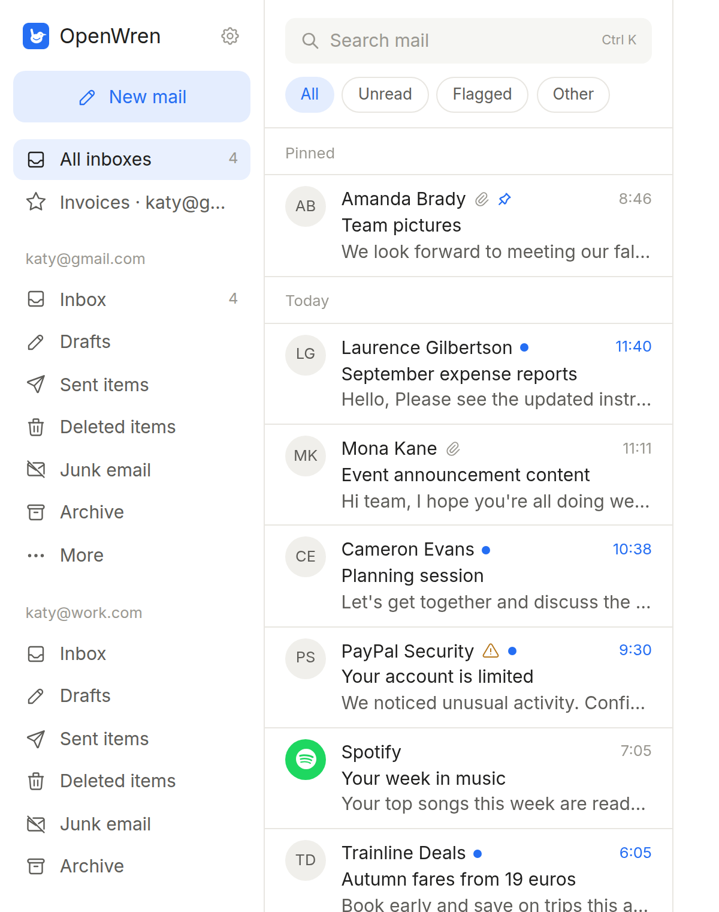</td>
<td>

**All your accounts, one inbox**

Gmail and any IMAP account side by side. "All inboxes" shows every account's mail together; star the folders you use most to keep them at the top.

</td>
</tr>
<tr>
<td width="46%">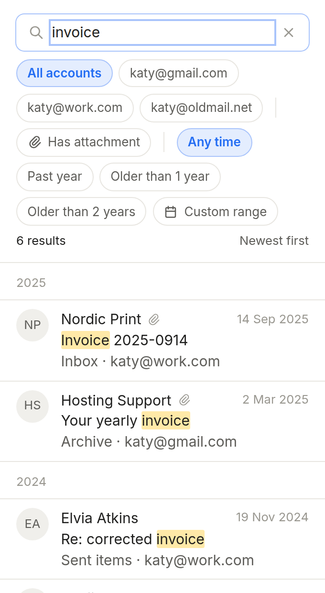</td>
<td>

**Search that reaches back years**

Every message is indexed on your computer, however old. Narrow by account, attachment or date, or type `from:`, `subject:`, `has:attachment`, `before:2024-01-31`. Text that is not downloaded yet can be searched on the server.

</td>
</tr>
<tr>
<td width="46%">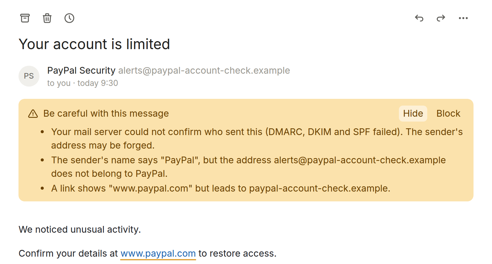</td>
<td>

**Warns you before you click**

A message is flagged when your mail server could not confirm the sender, when the name claims to be a company the address does not belong to, when a link shows one site but leads to another, or when an address imitates a known one with look-alike letters. One click blocks the sender.

</td>
</tr>
<tr>
<td width="46%">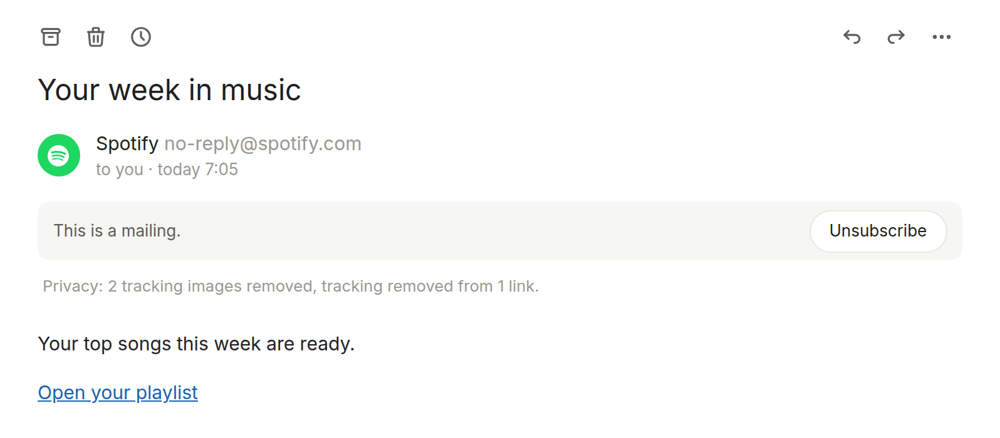</td>
<td>

**Removes trackers, offers unsubscribe**

Hidden images that report when you open a message are removed, and tracking codes are stripped from links. Pictures from the internet load only when you ask. Mailings get an Unsubscribe button that sends the request for you.

</td>
</tr>
<tr>
<td width="46%">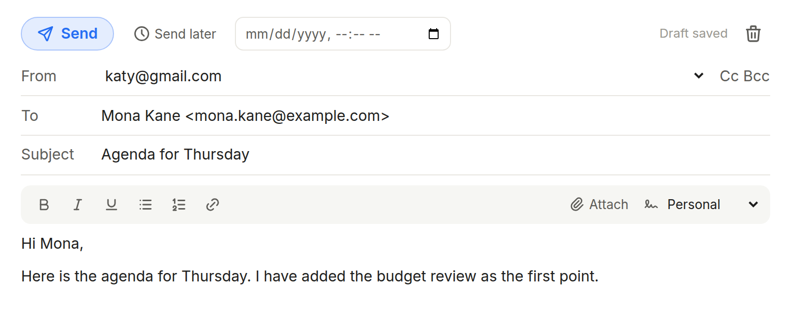</td>
<td>

**Write with less friction**

Rich text, signatures (with a picture if you like), attachments, send later, and a few seconds to undo a send. Drafts are saved as you type and kept on the server. A quick reply box sits under every message.

</td>
</tr>
<tr>
<td width="46%">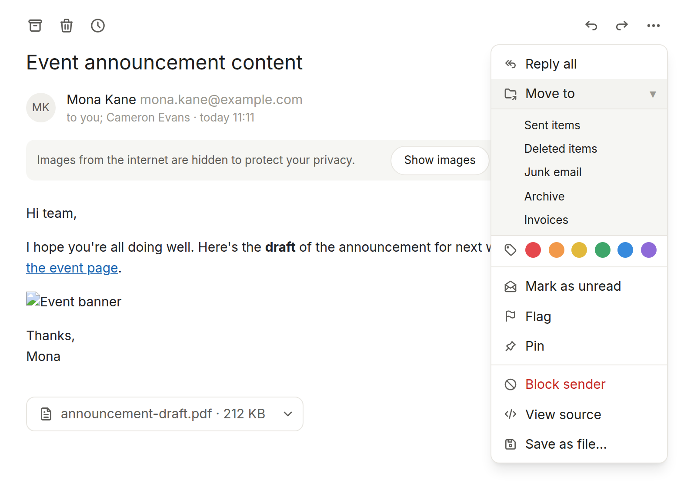</td>
<td>

**Keep on top of it**

Archive, delete and snooze are one click. Move by menu or by dragging onto a folder, mark with colours, pin, flag, set rules for new mail, and undo any of it.

</td>
</tr>
<tr>
<td width="46%">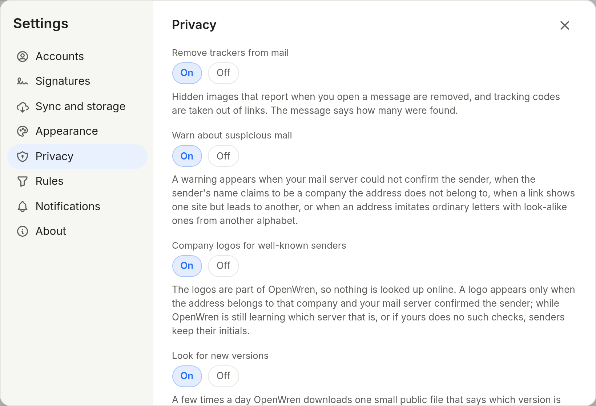</td>
<td>

**Private, and you can check**

Mail is stored in an encrypted database; passwords stay in the system keyring. Every protection has a switch, and Settings shows exactly what the one anonymous daily request contains.

</td>
</tr>
<tr>
<td width="46%">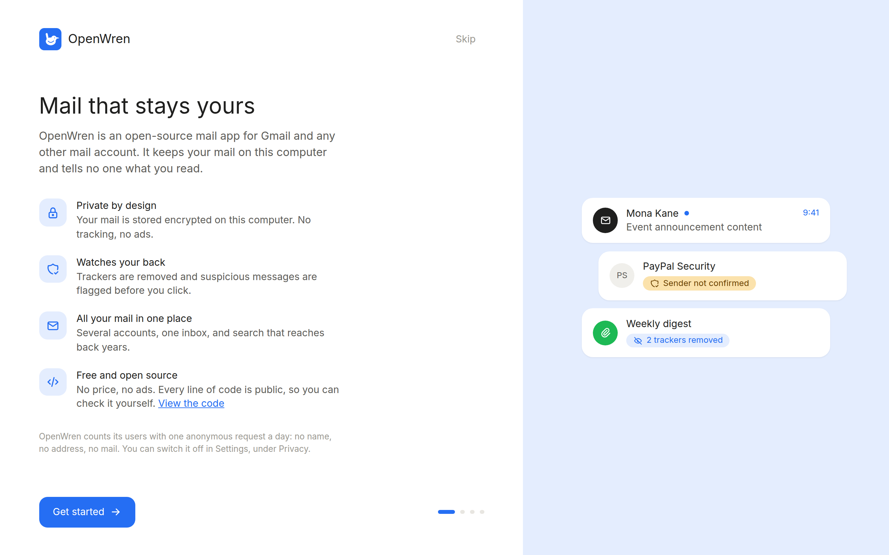</td>
<td>

**Set up in a minute**

A short welcome adds your first account and lets you pick the theme, text size and time format. Light and dark themes, three fonts, and a tray icon that keeps new-mail notifications coming.

</td>
</tr>
</table>

## Privacy

OpenWren has no server of its own that sees your mail. It talks to your mail
servers, and to nobody else unless you ask (showing remote images, signing in
with Google, unsubscribing).

One thing is on by default: once a day the app sends an anonymous request so
the project can count how many people use it. It carries the app version, the
kind of package and system, and nothing that identifies you; the server keeps
only totals. Switch it off in Settings → Privacy, where "Show what is sent"
displays the exact request. Details: [PRIVACY.md](PRIVACY.md).

## Built with

| Part | What it does | Why |
| --- | --- | --- |
| **Rust** | The engine: sync, parsing, search, sending, encryption | Memory-safe and fast, with no pauses for garbage collection |
| **Tauri 2** | The window, using the system's WebKitGTK | No bundled browser engine, so the download is about 14 MB |
| **SQLite + SQLCipher + FTS5** | Local storage, encrypted, with full-text search | One file, no database server, search that stays quick on large mailboxes |
| **tokio, async-imap, lettre, mail-parser, ammonia, rustls, keyring** | Mail protocols, parsing, HTML cleaning, TLS, credentials | Small, focused Rust libraries |
| **React 19, TypeScript, Vite, Tailwind CSS 4, zustand, TipTap** | The interface | Quick to build and change |

## How it works

The interface never touches the network or the database. It calls commands in
the Rust engine and listens for events; everything it shows is read from the
local database, which is why lists and messages appear at once.

For each account a background task keeps that database in step with the server:

1. Send the changes you made (moves, flags, drafts), queued if you were offline.
2. Fetch the folder list, then every folder's headers and flags, inbox first.
3. Download the text of the newest messages straight away, the rest in the background.
4. Wait for the server to announce new mail (IMAP IDLE), which arrives within a second or two.

Mail HTML is sanitised in Rust, then shown in a sandboxed frame with scripts off
and network access blocked until you choose "Show images".

```
src/                 interface (React, TypeScript)
  backend/           the only place that calls the engine; sample mail for `pnpm dev`
  features/          screens: folders, list, reading pane, composer, settings, welcome
src-tauri/src/       engine (Rust)
  lib.rs             commands the interface calls, background tasks
  sync.rs imap.rs    keeping the local database in step with the server
  db.rs              all the SQL
  parse.rs           reading and cleaning mail
  smtp.rs oauth.rs   sending, Google sign-in
stats/               the usage counter (Cloudflare Worker)
website/             openwren.app (Astro)
```

## Tests

```bash
pnpm typecheck && pnpm test
```

```bash
cargo test --manifest-path src-tauri/Cargo.toml
```

The end-to-end tests run against a local Dovecot mail server (needs Docker):

```bash
sh tests/mail-server.sh
```

```bash
OPENWREN_TEST_IMAP=127.0.0.1:3143 OPENWREN_TEST_SMTP=127.0.0.1:3025 cargo test --manifest-path src-tauri/Cargo.toml
```

`pnpm dev` runs the interface in a browser on sample mail, with no mail server
and no desktop app. `node scripts/screenshots.mjs` takes every picture in this
README from it, including the cover.

## Contributing

Bug reports, fixes and ideas are welcome. See [CONTRIBUTING.md](CONTRIBUTING.md)
for how to build, test and send a change, and [SECURITY.md](SECURITY.md) for
reporting a vulnerability privately.

## Known limits

- Linux only.
- One-click "Sign in with Google" for everyone needs Google's approval of the
  app, which has not been requested yet. Until then Gmail uses an app password.
- Categories, pins and snoozes are stored on this computer, not on the server.
- Server-side search understands plain ASCII words only.
- HTML mail is always shown on a white background, also in the dark theme.
- Blocking a sender moves their mail when OpenWren syncs, so it only works while the app runs.
- No Flatpak and no in-app update yet.

## Licence

[Apache-2.0](LICENSE). The name "OpenWren" and the logo are not covered by it;
see [TRADEMARKS.md](TRADEMARKS.md). Third-party components are listed in
[THIRD-PARTY-NOTICES.md](THIRD-PARTY-NOTICES.md).
